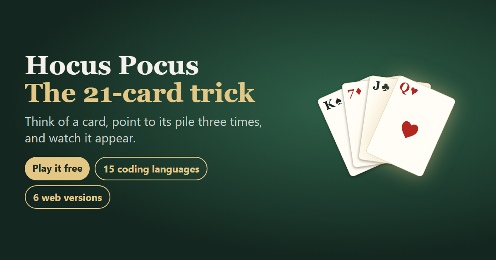
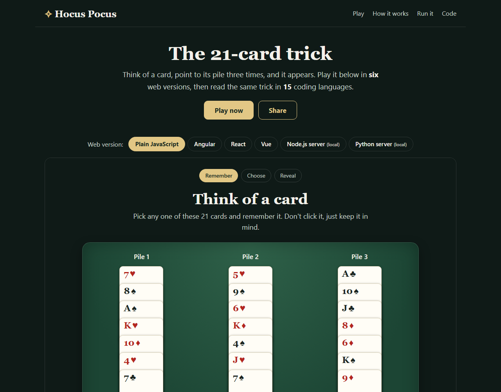
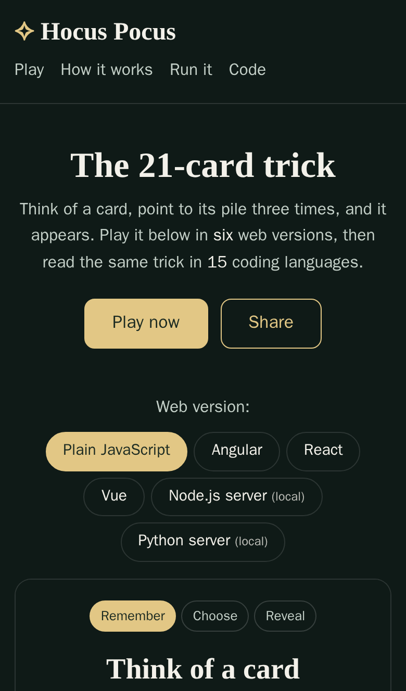
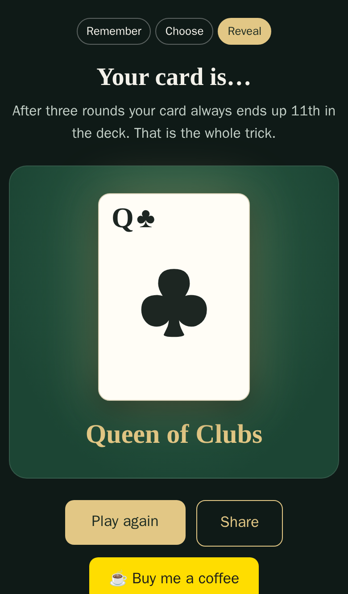
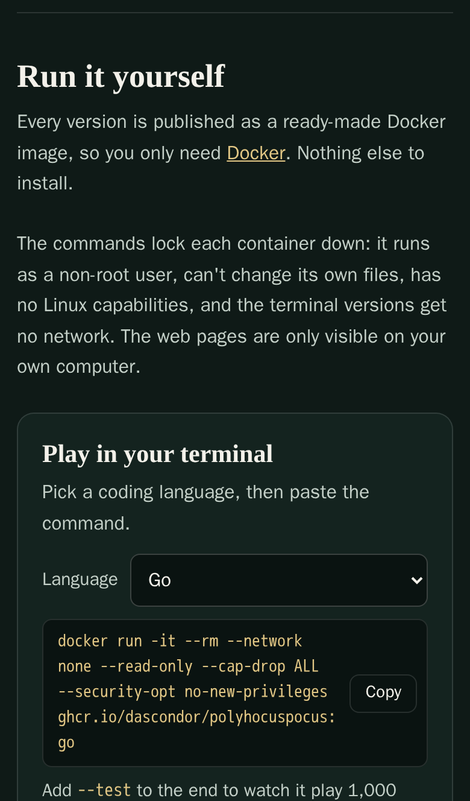

<div align="center">

<a href="https://dascondor.github.io/polyHocuspocus/">
  
</a>

# ✧ polyHocuspocus

**The classic 21-card trick, written in 15 coding languages and 6 web versions.**<br>
Think of a card. Point to its pile three times. Watch it appear.

[](https://dascondor.github.io/polyHocuspocus/)
[](https://buymeacoffee.com/dascondor)

[](https://github.com/DasCondor/polyHocuspocus/actions/workflows/ci.yml)
[](https://github.com/DasCondor/polyHocuspocus/pkgs/container/polyhocuspocus)


**[Play it](https://dascondor.github.io/polyHocuspocus/)** ·
**[Run it with Docker](#-run-it-with-docker)** ·
**[Read the code](https://dascondor.github.io/polyHocuspocus/#code)** ·
**[Share it](#-share-it)**

</div>

<br>

## Contents

- [✨ Features](#-features)
- [🎩 How the trick works](#-how-the-trick-works)
- [🐳 Run it with Docker](#-run-it-with-docker)
- [💻 Coding languages](#-coding-languages)
- [🌐 Web versions](#-web-versions)
- [📱 Share it](#-share-it)
- [🔒 Security](#-security)
- [🧪 Testing](#-testing)
- [🛠️ Working on the project](#️-working-on-the-project)
- [☕ Support development](#-support-development)

## ✨ Features

- **Play in your browser:** no install, no sign-up. Works with a mouse, touch or keys <kbd>1</kbd> <kbd>2</kbd> <kbd>3</kbd>.
- **Six web versions:** plain JavaScript, Angular, React, Vue, and server-rendered Node.js and Python. Switch between them on the page.
- **15 coding languages:** the same trick as a terminal program in each, from Python and Go to Bash and PowerShell.
- **Docker images for everything:** run any version with one `docker run` command, or build them all with `docker compose up`.
- **Locked-down containers:** every image runs as a non-root user on a read-only filesystem with no Linux capabilities, and the terminal versions get no network at all. Images are scanned, signed and shipped with an SBOM.
- **Easy to share:** a Share button on the page and on every "Your card is…" screen. Phones open the native share sheet; computers get WhatsApp, X, Facebook, Reddit, email and Copy link. Shared links show a preview card.
- **Buy me a coffee:** a ☕ button beside **Play again** after every trick, and at the bottom of the website.
- **Phone friendly:** large text, big tap targets, and layouts tested at phone size.
- **Tested on every push:** each version plays thousands of games against itself to prove the trick never misses.

<div align="center">
  
</div>

<table align="center">
  <tr>
    <td align="center"><br><sub>Pick a version</sub></td>
    <td align="center"><br><sub>The reveal: play again, share, or buy me a coffee</sub></td>
    <td align="center"><br><sub>Run it with Docker</sub></td>
  </tr>
</table>

## 🎩 How the trick works

1. Deal 21 cards into three piles of seven, one card at a time.
2. The player says which pile holds their card, and nothing else.
3. Pick the piles up **with that pile in the middle**, then deal again.
4. After three rounds the card is always the **11th** card in the deck.

| After | Where the card can be | Possible cards |
| :---: | :-------------------: | :------------: |
| Start |        1 – 21         |       21       |
| Round 1 |      8 – 14         |       7        |
| Round 2 |      10 – 12        |       3        |
| Round 3 |      **11**         |     **1**      |

Each round the chosen pile goes in the middle, and dealing spreads its seven cards back across the piles, so the card's possible positions shrink from 21 to 7 to 3 to 1. It is deduction, not a guess. Numberphile has a [great video on the maths](https://youtu.be/d7dg7gVDWyg).

## 🐳 Run it with Docker

Every version is published as a ready-made image at **[ghcr.io/dascondor/polyhocuspocus](https://github.com/DasCondor/polyHocuspocus/pkgs/container/polyhocuspocus)**, so all you need is [Docker](https://docs.docker.com/get-started/get-docker/). No clone and nothing else to install.

**The whole website** (all six web versions and the code viewer), then open <http://localhost:8080>:

```powershell
docker run --rm --read-only --cap-drop ALL --security-opt no-new-privileges --tmpfs /tmp -p 127.0.0.1:8080:8080 ghcr.io/dascondor/polyhocuspocus:site
```

**A coding language in your terminal.** Swap `go` for any tag in the [table below](#-coding-languages):

```powershell
docker run -it --rm --network none --read-only --cap-drop ALL --security-opt no-new-privileges ghcr.io/dascondor/polyhocuspocus:go
```

Add `--test` to the end to watch it play 1,000 games against itself. For `powershell`, also add `--tmpfs /tmp` before the image name.

**The server versions:** Node.js on <http://localhost:3000>, Python on <http://localhost:8000>:

```powershell
docker run --rm --read-only --cap-drop ALL --security-opt no-new-privileges -p 127.0.0.1:3000:3000 ghcr.io/dascondor/polyhocuspocus:node-web
```

```powershell
docker run --rm --read-only --cap-drop ALL --security-opt no-new-privileges -p 127.0.0.1:8000:8000 ghcr.io/dascondor/polyhocuspocus:python-web
```

The extra flags lock each container down: no writing to its files, no Linux capabilities, no way to gain privileges, and no network for the terminal versions. `127.0.0.1:` keeps the web pages visible only on your own computer, not on your network. See [🔒 Security](#-security).

<details>
<summary><b>Build the images yourself with Docker Compose</b></summary>

<br>

[`compose.yaml`](compose.yaml) has a service for every version, built from the files in [`docker/`](docker). Compiled languages use multi-stage builds, so the final images hold only the program.

```powershell
git clone https://github.com/DasCondor/polyHocuspocus.git
cd polyHocuspocus
docker compose up                   # website :8080, Node.js :3000, Python :8000
docker compose run --rm go          # one language in your terminal
docker compose run --rm go --test   # its 1,000-game self-test
docker compose pull                 # download the published images instead of building
```

The terminal versions are in the `cli` profile, so `docker compose up` leaves them out. Every service already has the lock-down settings, plus memory, CPU and process limits.

</details>

## 💻 Coding languages

Each terminal version is a single file with no third-party packages. They all show the same three piles, ask `Which pile holds your card? [1-3]` three times, then reveal the card:

```text
HOCUS POCUS - the 21-card trick
Remember one card. Don't say it - just tell me which pile it is in.

Round 1 of 3
  Pile 1              Pile 2              Pile 3
  8 of Hearts         Ace of Hearts       Ace of Clubs
  3 of Clubs          4 of Hearts         Jack of Clubs
  ...

Which pile holds your card? [1-3]: 2
...
Hocus pocus... your card is the Queen of Hearts!
```

Run from the repository root with the language installed, or use the Docker tag:

| Language | Run it | Docker tag |
| --- | --- | --- |
| [Python](python/hocuspocus.py) | `python python/hocuspocus.py` | [`python`](docker/python.Dockerfile) |
| [JavaScript](javascript/hocuspocus.js) | `node javascript/hocuspocus.js` | [`javascript`](docker/javascript.Dockerfile) |
| [TypeScript](typescript/hocuspocus.ts) | `node typescript/hocuspocus.ts` (Node.js 22.18+) | [`typescript`](docker/typescript.Dockerfile) |
| [Go](go/hocuspocus.go) | `go run go/hocuspocus.go` | [`go`](docker/go.Dockerfile) |
| [Rust](rust/hocuspocus.rs) | `rustc -O rust/hocuspocus.rs -o hocuspocus && ./hocuspocus` | [`rust`](docker/rust.Dockerfile) |
| [C](c/hocuspocus.c) | `cc -O2 c/hocuspocus.c -o hocuspocus && ./hocuspocus` | [`c`](docker/c.Dockerfile) |
| [C++](cpp/hocuspocus.cpp) | `c++ -std=c++17 -O2 cpp/hocuspocus.cpp -o hocuspocus && ./hocuspocus` | [`cpp`](docker/cpp.Dockerfile) |
| [C#](csharp/Program.cs) | `dotnet run --project csharp` | [`csharp`](docker/csharp.Dockerfile) |
| [Java](java/HocusPocus.java) | `java java/HocusPocus.java` | [`java`](docker/java.Dockerfile) |
| [Kotlin](kotlin/hocuspocus.kt) | `kotlinc kotlin/hocuspocus.kt -include-runtime -d hocuspocus.jar && java -jar hocuspocus.jar` | [`kotlin`](docker/kotlin.Dockerfile) |
| [Ruby](ruby/hocuspocus.rb) | `ruby ruby/hocuspocus.rb` | [`ruby`](docker/ruby.Dockerfile) |
| [Lua](lua/hocuspocus.lua) | `lua lua/hocuspocus.lua` | [`lua`](docker/lua.Dockerfile) |
| [Perl](perl/hocuspocus.pl) | `perl perl/hocuspocus.pl` | [`perl`](docker/perl.Dockerfile) |
| [Bash](bash/hocuspocus.sh) | `bash bash/hocuspocus.sh` | [`bash`](docker/bash.Dockerfile) |
| [PowerShell](powershell/hocuspocus.ps1) | `pwsh powershell/hocuspocus.ps1` | [`powershell`](docker/powershell.Dockerfile) |

The first Python version from pyHocuspocus is kept unchanged in [`python/original/`](python/original).

## 🌐 Web versions

All six share one stylesheet, [`web/shared/hocuspocus.css`](web/shared/hocuspocus.css), so they look and play the same. Only the code behind them differs. Play the first four on the [website](https://dascondor.github.io/polyHocuspocus/).

| Version | Code | Run it locally | Docker |
| --- | --- | --- | --- |
| Plain JavaScript | [`web/vanilla/app.js`](web/vanilla/app.js) | Open `web/vanilla/index.html` | `site` |
| Angular | [`web/angular/src/app/app.ts`](web/angular/src/app/app.ts) | `cd web/angular && npm install && npm start` | `site` |
| React | [`web/react/src/App.jsx`](web/react/src/App.jsx) | `cd web/react && npm install && npm run dev` | `site` |
| Vue | [`web/vue/src/App.vue`](web/vue/src/App.vue) | `cd web/vue && npm install && npm run dev` | `site` |
| Node.js server | [`web/node/server.js`](web/node/server.js) | `node web/node/server.js` → <http://localhost:3000> | `node-web` |
| Python server | [`web/python/server.py`](web/python/server.py) | `python web/python/server.py` → <http://localhost:8000> | `python-web` |

The Node.js and Python versions build every page on the server and keep the game in the links, so the browser runs no JavaScript and neither needs any packages. GitHub Pages only hosts static files, so the website shows a preview of these two and the command to run them.

## 📱 Share it

- **On the website:** the **Share** button under the title, or in the footer.
- **After a trick:** every "Your card is…" screen has **Share** and **☕ Buy me a coffee** buttons next to **Play again**. The share message names the card it found.
- **On a phone** it opens your phone's own share sheet. **On a computer** it offers WhatsApp, X, Facebook, Reddit, email and Copy link.
- The two server versions share with plain links, so sharing works there with no JavaScript too.

Or just send the link: **<https://dascondor.github.io/polyHocuspocus/>**. It shows a preview card in chat apps and on social media.

## 🔒 Security

The containers are locked down so that a program inside one can reach as little of your computer as possible.

| Protection | What it means |
| --- | --- |
| **Non-root user** | Every image runs as an unprivileged user (UID 65532, 65534, 1654 or 100), never root. CI fails if one doesn't. |
| **Minimal images** | Go, Rust, C and C++ are a single static binary on an empty `scratch` image. Python, Node.js, Java and C# use [distroless](https://github.com/GoogleContainerTools/distroless) or chiseled images with no shell and no package manager. The rest are Alpine with the package manager removed. |
| **Read-only filesystem** | Containers can't change their own files. Only `site` and `powershell` get a small `/tmp` in memory, mounted `noexec`. |
| **No capabilities, no escalation** | `--cap-drop ALL` removes every Linux capability, and `no-new-privileges` stops setuid programs from gaining any. Docker's default seccomp profile stays on. |
| **No network** | Terminal versions run with `--network none`. The web servers publish their port on `127.0.0.1` only, so other devices on your network can't reach them. |
| **Resource limits** | In Compose, each container gets a memory cap, one CPU, and a process limit. |
| **Safe web pages** | Every web version sends a strict Content-Security-Policy, `nosniff`, a Referrer-Policy, a Permissions-Policy and anti-framing headers. The two servers accept only `GET`/`HEAD`, check every value in the link, bind to `127.0.0.1` by default, and drop slow connections. highlight.js loads with Subresource Integrity. |

**Supply chain**

- Every base image is pinned by its `sha256` digest, and every GitHub Action by its full commit SHA. [Dependabot](.github/dependabot.yml) proposes updates weekly.
- Downloads in the builds (the Kotlin compiler and PowerShell) are checked against their published SHA-256. `npm ci --ignore-scripts` stops packages from running install scripts.
- CI scans the Dockerfiles and every image with [Trivy](https://trivy.dev) and fails on any fixable HIGH or CRITICAL vulnerability. `npm audit` checks the web apps, and [CodeQL](.github/workflows/codeql.yml) checks the code.
- Published images carry an SBOM and build provenance, and are signed with [Sigstore](https://www.sigstore.dev/) by the CI workflow. To verify an image:

```powershell
cosign verify ghcr.io/dascondor/polyhocuspocus:go --certificate-oidc-issuer https://token.actions.githubusercontent.com --certificate-identity https://github.com/DasCondor/polyHocuspocus/.github/workflows/ci.yml@refs/heads/main
```

Found a security problem? See [SECURITY.md](SECURITY.md).

## 🧪 Testing

[`ci.yml`](.github/workflows/ci.yml) runs on every push:

| Job | What it checks |
| --- | --- |
| **Languages** | Builds each terminal version with its own toolchain, runs the 1,000-game self-test, and plays a game from piped answers. |
| **Docker images** | Scans the Dockerfiles, builds every image, checks none runs as root, checks the lock-down from inside a container, repeats the self-test inside each image, plays 50 games against both server images, and scans every image for vulnerabilities. |
| **Web versions** | Builds Angular, React and Vue, audits their packages, assembles the site, and plays 50 games against the Node.js and Python servers with [`tools/test_web_server.py`](tools/test_web_server.py). |
| **Publish** | After everything passes on `main`: pushes the images to `ghcr.io` with an SBOM and provenance, then signs them. It is the only job that can write packages. |

The website is redeployed only when all of these pass.

## 🛠️ Working on the project

<details>
<summary><b>Preview the website without Docker</b></summary>

<br>

Build the three framework apps (`npm install && npm run build` in `web/angular`, `web/react` and `web/vue`), then:

```powershell
py tools/build_site.py
py -m http.server 8000 --directory _site
```

</details>

<details>
<summary><b>Add a language</b></summary>

<br>

1. Add a folder with the program. Give it a `--test` option like the others.
2. Add an entry to [`languages.json`](languages.json) so the website lists it.
3. Add `docker/<name>.Dockerfile` and a service in [`compose.yaml`](compose.yaml).
4. Add a line to the test matrix in [`ci.yml`](.github/workflows/ci.yml).

</details>

<details>
<summary><b>Update the screenshots and the link preview</b></summary>

<br>

Start the site and servers with `docker compose up --build`, then run [`tools/screenshots.ps1`](tools/screenshots.ps1) on Windows. It renders the link preview from [`tools/social-card.html`](tools/social-card.html), the home-screen icon, the server previews and the README images with headless Microsoft Edge. The phone-sized shots use Playwright in Docker ([`tools/phone-shot.mjs`](tools/phone-shot.mjs)), because the pages refuse to be shown inside a frame.

</details>

<details>
<summary><b>Project layout</b></summary>

<br>

```text
polyHocuspocus/
├── python/ javascript/ typescript/ go/ rust/ c/ cpp/
├── csharp/ java/ kotlin/ ruby/ lua/ perl/ bash/ powershell/
├── python/original/    # The first version, from pyHocuspocus
├── web/
│   ├── shared/         # hocuspocus.css, used by every web version
│   ├── vanilla/ angular/ react/ vue/
│   └── node/ python/   # Server-rendered versions
├── docker/             # One hardened Dockerfile per version, plus nginx.conf
├── compose.yaml
├── site/               # The main page: version switcher, Docker how-to, code viewer
├── media/              # README screenshots
├── languages.json      # Every version the website lists
├── SECURITY.md         # How to report a vulnerability
└── tools/              # Site builder, server test, screenshots
```

</details>

This project grew out of [pyHocuspocus](https://github.com/DasCondor/pyHocuspocus).

## ☕ Support development

<a href="https://buymeacoffee.com/dascondor">
  
</a>

If this project made you smile or helped you learn something, you can **[buy me a coffee](https://buymeacoffee.com/dascondor)** to support future work. The ☕ button also appears next to **Play again** after every trick and at the bottom of the website. Contributions are voluntary, and sharing the trick with a friend helps too.

<br clear="left">

<div align="center">

[](https://buymeacoffee.com/dascondor)

</div>
